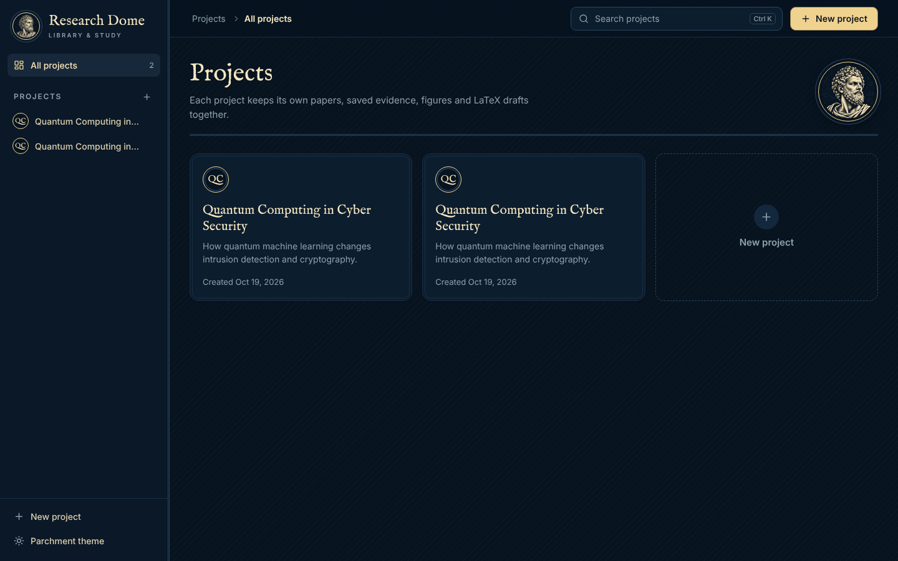
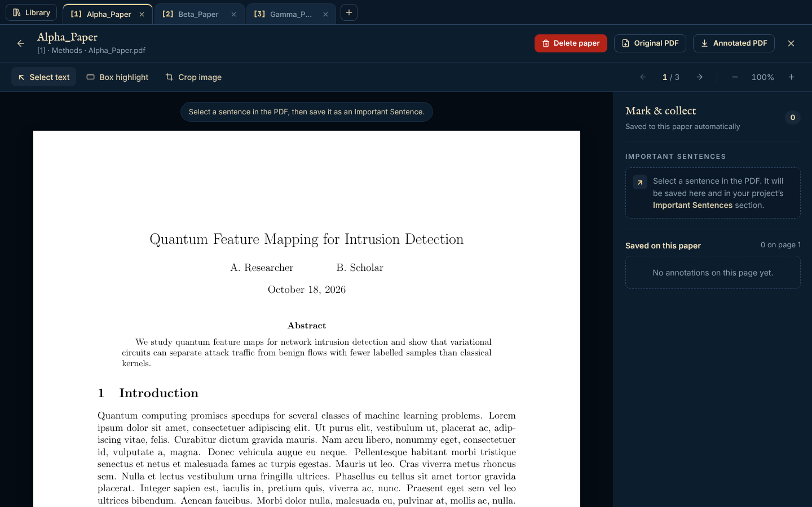
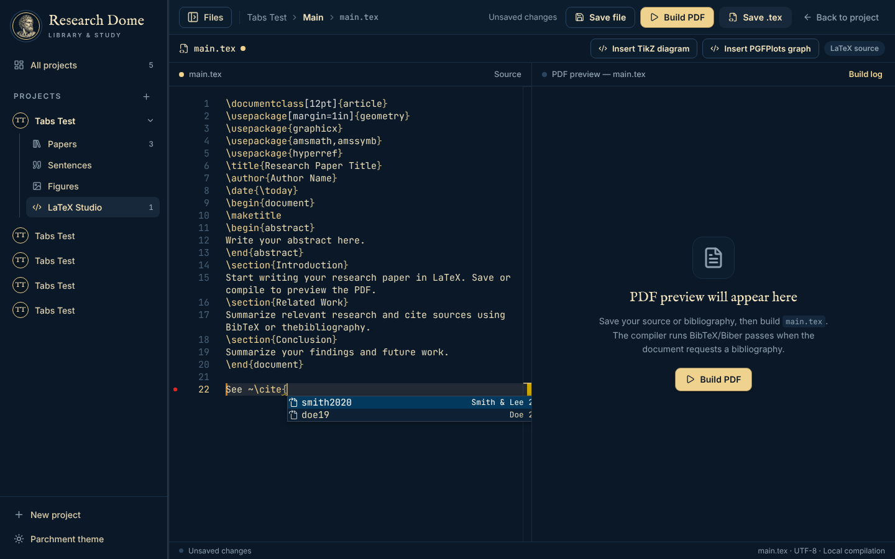
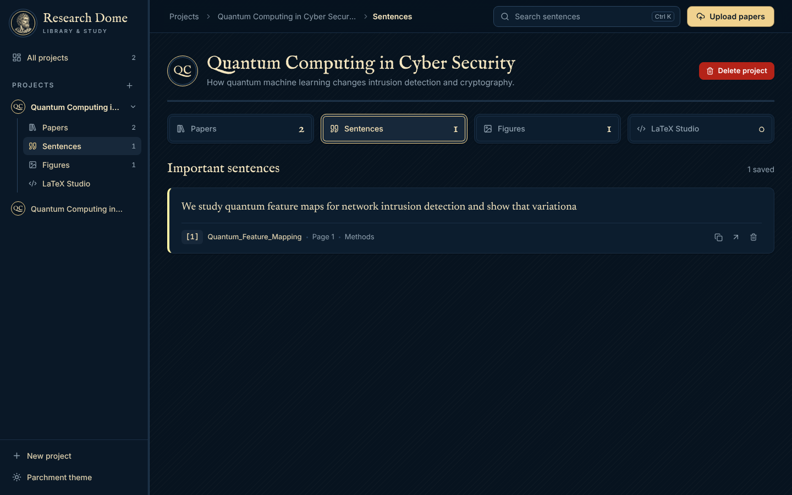
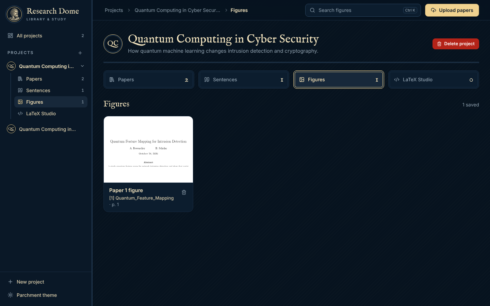
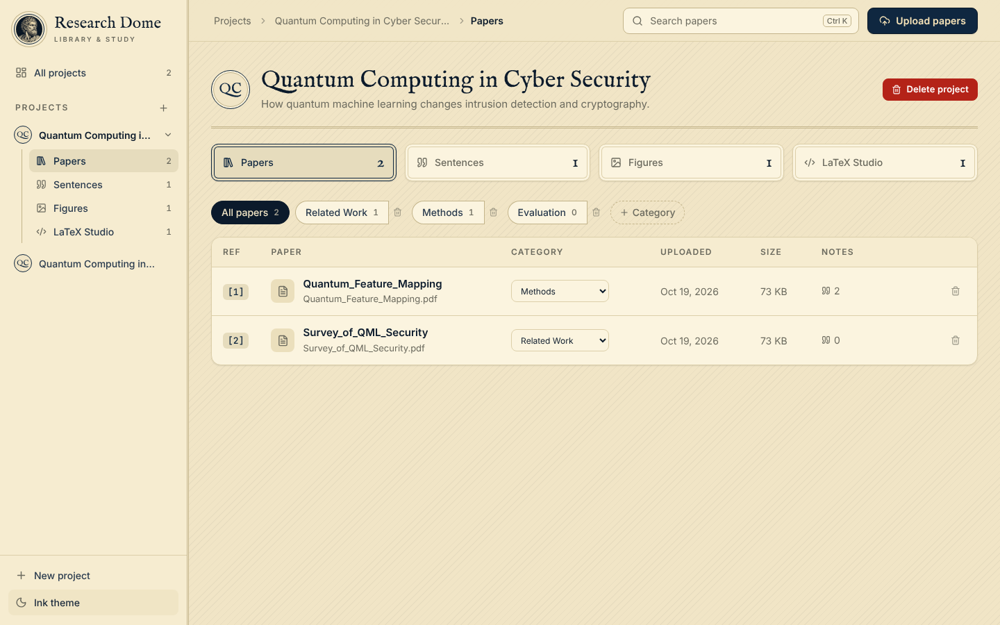

<div align="center">


# Research Dome

**A private, offline research library for your desktop.**
Organise papers, read and annotate PDFs in tabs, collect evidence and figures, and write your paper in LaTeX — all on your own computer.

[](https://opensource.org/license/mit)


[Download](#-download) · [Features](#-features) · [Demo](#-demo) · [Build from source](#-build-from-source) · [Publishing releases](docs/RELEASING.md)

</div>

---

## 🎬 Demo

<div align="center">

[](https://youtu.be/wbeEpigsqVM)

**▶ [Watch the demo on YouTube](https://youtu.be/wbeEpigsqVM)**

</div>

<div align="center">
  
  <br/><sub>Read several papers at once in tabs, highlight sentences, draw boxes and crop figures.</sub>
</div>

## ✨ Features

| | |
|---|---|
| 📚 **Projects & categories** | One project per research topic; group papers into categories such as *Related Work* or *Methods*. Every paper gets a stable citation number. |
| 🗂 **PDF reader with tabs** | Open many PDFs at once and switch like browser tabs (`Ctrl+Tab`, `Ctrl+W`). Tabs are restored next time you open the project. |
| 🖍 **Annotate** | Save important sentences, draw box highlights, and crop figures straight from the page. |
| 🖼 **Evidence & figures** | All saved sentences and cropped figures are collected per project, each linked back to its source page. |
| 📄 **Annotated PDF export** | Download a copy of any paper with your highlights and boxes drawn on it. |
| ✍️ **LaTeX Studio** | Multi-file LaTeX projects with a built-in editor, live diagnostics, one-click **Build PDF** (pdfLaTeX + BibTeX/Biber) and a live preview. |
| 💡 **Offline suggestions** | Type `\cite{` for keys from your `.bib` files, `\includegraphics{` for your uploaded images, `\ref{` for your labels, `\input{` for your `.tex` files. |
| 🌗 **Two themes** | *Ink* (dark navy and cream) and *Parchment* (light). |
| 🔒 **Private by design** | No account, no cloud, no telemetry. Everything is stored in a local SQLite database and a folder on your disk. Works fully offline. |

<div align="center">
  
  
  
  
</div>

## 📥 Download

> [!IMPORTANT]
> **Read this before you build a PDF: a LaTeX installation is required.**
> Research Dome does not ship with LaTeX, so **Build PDF** in LaTeX Studio only works after you install one. It is a different tool on each system: **MiKTeX** on Windows, **MacTeX** on macOS, and **TeX Live** on Linux. See [LaTeX setup](#latex-setup-required-for-build-pdf) below for the exact steps for your system. Everything else in the app works without it.
>
> ⏱ **The first PDF build takes longer** (it can take a few minutes). LaTeX sets up its fonts and may download the packages your document needs, so the first build can also need an internet connection. Later builds are much faster.

Get the latest installer for your system from the **[Releases page](https://github.com/nvedant/research-dome/releases/latest)**.

| System | File to download | Notes |
|---|---|---|
| **Windows 10 / 11** | `…_x64-setup.exe` (or `.msi`) | Double-click to install. No admin rights needed. |
| **macOS** (Apple Silicon & Intel) | `…_universal.dmg` | Drag *Research Dome* to Applications. |
| **Linux** (Debian/Ubuntu) | `….deb` | `sudo apt install ./research-dome_*.deb` |
| **Linux** (any distro) | `….AppImage` | `chmod +x *.AppImage && ./*.AppImage` |
| **Linux** (Fedora/RHEL) | `….rpm` | `sudo dnf install ./research-dome-*.rpm` |

No Python, Node, database or Docker is needed to **run** the app.

### First launch

The app is not code-signed yet, so your system may show a one-time warning:

- **Windows** — *"Windows protected your PC"*: click **More info → Run anyway**.
- **macOS** — right-click the app → **Open** → **Open**. If macOS says the app is *"damaged"*, run
  `xattr -cr "/Applications/Research Dome.app"` once.
- **Linux** — none for `.deb`/`.rpm`; make the AppImage executable as shown above.

### LaTeX setup (required for Build PDF)
 
Building a PDF in LaTeX Studio needs a TeX distribution installed on your system. Everything else in the app works without it.

> **Note:** the first PDF build is slow (a few minutes) while LaTeX prepares fonts and fetches missing packages; after that, builds take seconds.
 
| System | Install |
|---|---|
| **Windows** | [MiKTeX](https://miktex.org) |
| **macOS** | [MacTeX](https://tug.org/mactex/) |
| **Linux** (Debian/Ubuntu) | `sudo apt install texlive-full` |
| **Linux** (Arch) | Choose one of the two options below |
 
#### Arch Linux
 
>  Either option is a large download (up to about **2.5 GB**).
 
**Option 1 — Academic bundle** *(recommended for IEEE, ACM, Springer LNCS and Elsevier formats)*
 
```bash
sudo pacman -S texlive-basic texlive-bin texlive-latex texlive-latexrecommended \
  texlive-latexextra texlive-publishers texlive-mathscience texlive-fontsrecommended \
  texlive-fontsextra texlive-bibtexextra texlive-binextra biber
```
 
Includes:
 
- **Publisher classes:** `IEEEtran.cls`, `acmart.cls`, `llncs.cls`
- **CS & math packages:** `algpseudocode`, `algorithm2e`, `siunitx`
- **Publisher fonts:** `newtx`, `libertine`
- **Bibliography styles:** BibTeX/Biber styles such as `biblatex-ieee`
- **Build tool:** `latexmk`

**Option 2 — Full TeX Live** *(all-in-one, so you never hit a missing-package error)*
 
```bash
sudo pacman -S texlive-meta biber
```

### Where your data lives

| System | Folder |
|---|---|
| Windows | `%APPDATA%\com.researchdome.app` |
| macOS | `~/Library/Application Support/com.researchdome.app` |
| Linux | `~/.local/share/com.researchdome.app` |

It contains `research-dome.sqlite`, a `storage/` folder (PDFs, figures, LaTeX projects) and `logs/`. Copy this folder to back up or move your library. Uninstalling the app does **not** delete it. Set `RESEARCH_DOME_DATA_DIR` to use a different location.

## 🛠 Build from source

### Prerequisites

- [Rust](https://rustup.rs) (stable)
- [Node.js](https://nodejs.org) 22 or newer
- **Windows:** Visual Studio Build Tools with the *Desktop development with C++* workload (WebView2 ships with Windows 10/11)
- **macOS:** `xcode-select --install`
- **Linux:** `sudo apt install libwebkit2gtk-4.1-dev libgtk-3-dev librsvg2-dev libssl-dev patchelf build-essential`

### Commands

```bash
npm install            # install frontend dependencies
npm run app:dev        # run the desktop app in development mode
npm run app:build      # build the installers for your current OS
npm run test:core      # run the backend integration tests
```

Installers are written to `target/release/bundle/`:

| OS | Output |
|---|---|
| Windows | `nsis/*-setup.exe`, `msi/*.msi` |
| macOS | `dmg/*.dmg`, `macos/*.app` |
| Linux | `deb/*.deb`, `appimage/*.AppImage`, `rpm/*.rpm` |

An installer can only be built **on its own operating system**. To build all three at once, use the included GitHub Actions workflow — see **[docs/RELEASING.md](docs/RELEASING.md)**.

## 🏗 Architecture

```
┌──────────────────────── Tauri desktop window ────────────────────────┐
│  React 19 + Vite UI  (PDF.js reader, Monaco LaTeX editor, themes)    │
└───────────────▲──────────────────────────────────────────────────────┘
                │  HTTP on 127.0.0.1 (random port, per-launch secret token)
┌───────────────┴──────────────────────────────────────────────────────┐
│  research-dome-core (Rust)                                            │
│   axum REST API · SQLite (rusqlite, WAL, migrations) · lopdf export   │
│   LaTeX pipeline (pdflatex → biber/bibtex) · local file storage       │
└──────────────────────────────────────────────────────────────────────┘
```

| Path | What it is |
|---|---|
| `core/` | The Rust backend library and the headless `dome-server` binary (`npm run server`). |
| `src-tauri/` | The Tauri shell: window, native *Save as…* dialogs, single-instance guard. |
| `src/` | The React frontend. |
| `docs/` | Release guide and screenshots. |

The internal API listens on `127.0.0.1` only and every request needs a token generated at each launch, so nothing else on the machine or network can reach it.

## 🤝 Contributing

Issues and pull requests are welcome. Please run `npm run test:core` and `npx vite build` before opening a PR.

## 📄 License

[MIT](https://opensource.org/license/mit) © Research Dome contributors
